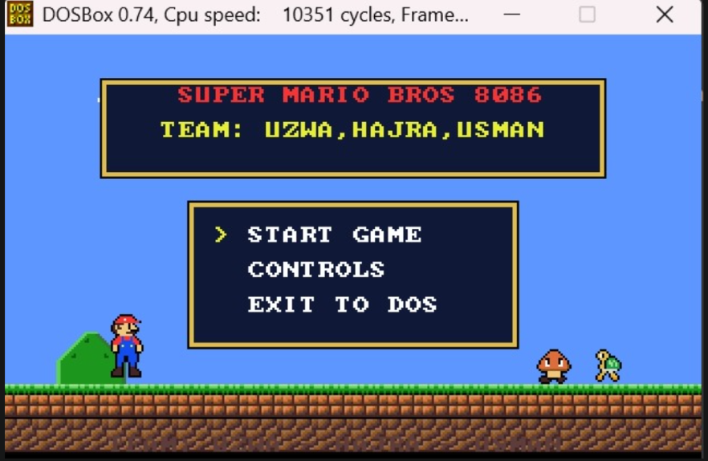

# 🍄 Super Mario Bros — 8086 Assembly Edition

<p align="center">
  <strong>A retro platformer built with 8086 Assembly Language</strong><br>
  <em>Low-level programming meets classic platform-game mechanics.</em>
</p>

<!-- Replace the path below after adding a genuine gameplay screenshot. -->
<p align="center">
  
</p>

## 🎮 About

Super Mario Bros — 8086 Assembly Edition is a team-developed, Mario-inspired platform game written in 8086 Assembly. It brings together player movement, platform and object collision handling, enemies, sprite rendering, level logic, input handling, timing and a heads-up display through a modular assembly codebase.

## ✨ Features

- Platform-style gameplay and player movement
- Jumping and movement physics
- Enemy behavior and stomp interactions
- Shell interactions
- Collision detection and resolution
- Coin and score-related game logic
- Timer and HUD display
- Menus and game-state transitions
- Low-level sprite and framebuffer rendering

## 🎬 Gameplay

<!-- Add a short, real gameplay recording converted to GIF at assets/gameplay.gif. -->

> **Media note:** Add `assets/gameplay.png` and `assets/gameplay.gif` to the repository to activate the visuals above. These are intended to be captured from the running game, not mock-ups.

## 🕹️ Controls

| Key | Action |
|---|---|
| Left Arrow | Move left |
| Right Arrow | Move right |
| Left Shift | Run / faster movement |
| Space | Jump |
| P | Pause |
| Enter | Confirm / continue (where applicable) |
| Esc | Back / exit (depending on game state) |

## 🧩 Project Modules

| Source file | Responsibility |
|---|---|
| `main.asm` | Main program flow and game loop |
| `graphics.asm` | Rendering, sprite drawing and framebuffer routines |
| `level.asm` | Level setup and level/game-state logic |
| `menu.asm` | Menu and game-state screens |
| `player.asm` | Player movement and physics |
| `collis.asm` | Collision checks and resolution |
| `enemies.asm` | Enemy AI, shells and stomp behavior |
| `hud.asm` | HUD and score-related display |
| `keyboard.asm` | Keyboard input handling |
| `timer.asm` | Timer and frame synchronization |
| `data.asm` | Shared constants, data and variables |

## 🛠️ Built With

- 8086 Assembly Language
- NASM (Netwide Assembler)
- DOS `.COM` executable format
- BIOS/DOS-oriented low-level programming

## ▶️ Build & Run

### Requirements

- NASM
- A DOS-compatible environment or DOS emulator (such as DOSBox) on modern systems

### Build

The included `build.BAT` assembles `MAIN.ASM` into `MARIO.COM` using NASM. Check the script's NASM path and adjust it to your installation if necessary.

```bat
build.BAT
```

### Run

Run `MARIO.COM` inside a compatible DOS environment.

## 👥 Team & Contributions

The following responsibilities are based on the ownership notes in the project source files and project guide.

### Uzwa
- Program skeleton, setup and main-state flow
- Video-mode setup and restoration
- Level/map setup and tile data/rendering
- Camera scrolling
- Title, pause, win and game-over screens
- Exit and interrupt cleanup

### Hajra
- Player physics and movement
- Keyboard interrupt handler and key flags
- Timer interrupt and frame timing
- Block/item interactions and pickups
- Score, coins, timer and HUD rendering

### Usman
- Collision checks and collision support
- Enemy AI, shell mechanics and stomp behavior
- Sprite-rendering routines (shared contribution)
- Frame-buffer operations

## 📚 Learning Goals

This project applies and demonstrates:

- Modular assembly programming
- 8086 architecture and low-level programming
- Game loops and state machines
- Input handling and timing
- Graphics and framebuffer operations
- Collision detection and resolution
- Player physics and enemy behavior
- Collaborative development and integration

---

<p align="center"><strong>Built with Assembly — inspired by the classics. 🍄</strong></p>
